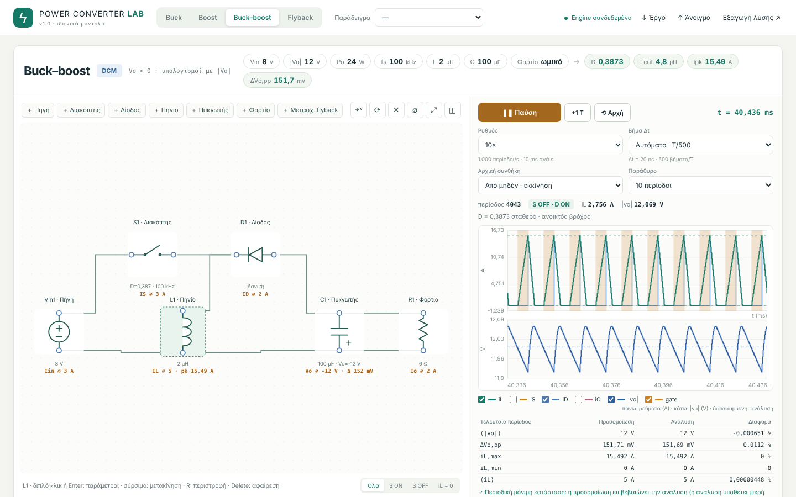

# Power Converter Lab

**Διαδραστικό εργαστήριο DC–DC μετατροπέων για την Ηλεκτρονική Ισχύος Ι.**
Buck, boost, αντιστρέφων buck–boost και flyback: φτιάχνεις ή αλλάζεις το
κύκλωμα, δίνεις τιμές με διπλό κλικ στα στοιχεία και παίρνεις duty,
περιοχή αγωγής (CCM / BCM / DCM), Lcrit, ρεύματα, κυμάτωση τάσης και
απαιτούμενο C, μαζί με τις εξισώσεις και την αριθμητική αντικατάσταση.
Δίπλα τρέχει ζωντανή προσομοίωση του κυκλώματος στον χρόνο, με ρυθμό και
βήμα Δt της επιλογής σου.

Τρέχει τοπικά: Python για τον υπολογιστικό πυρήνα, ο browser για το GUI.
Δεν χρειάζεται λογαριασμός, internet (μετά την εγκατάσταση), GPU ή MATLAB.



## Τι κάνει

- **Κύκλωμα που επεξεργάζεσαι.** Σύρσιμο στοιχείων, καλωδίωση, περιστροφή.
  Ο engine αναγνωρίζει την τοπολογία από τη συνδεσμολογία και αρνείται
  ρητά κυκλώματα που δεν αντιστοιχούν σε υποστηριζόμενη οικογένεια.
- **Διπλό κλικ σε στοιχείο** → τιμές και αποτελέσματα του στοιχείου
  (π.χ. πηνίο: L, Lcrit, ΔiL, Imin/Ipk, RMS · πυκνωτής: C, ΔVo,pp, Δq,
  C για στόχο κυμάτωσης). Κάθε αλλαγή ξαναλύνεται αυτόματα.
- **Αναλυτική λύση με εξισώσεις:** iL, iS, iD, iC ανά διάστημα,
  ολοκλήρωση iC → q(t), ακρότατα φορτίου, ΔVo,pp = Δq/C, Cmin, μέσες και
  RMS τιμές, με αριθμητική αντικατάσταση σε κάθε βήμα.
- **Ζωντανή προσομοίωση:** ρυθμός 10× … 1× … 0,001× (1× = 100 περίοδοι/s),
  βήμα Δt από T/50 έως T/5000 ή σε ns, εκκίνηση από μηδέν ή από το σημείο
  λειτουργίας, παλμογράφος iL / iS / iD / iC / |vo| / gate, ζωντανές τιμές
  πάνω στα στοιχεία και σύγκριση με την ανάλυση.
- **Σχεδίαση:** ελάχιστο L για CCM ή μέγιστο για DCM σε εύρη Vin/Vo,
  Vin ή Vo που φέρνουν το κύκλωμα σε BCM (όλες οι φυσικές ρίζες),
  C από επιτρεπόμενη κυμάτωση, παραμετρικοί χάρτες CCM/DCM.
- **Δυναμική:** μέσο μοντέλο, γραμμικοποίηση, Gvd(s)/Gvg(s) με πλήρη
  απόδειξη, πόλοι/μηδενικά, Bode (CCM και DCM χαμηλών συχνοτήτων).
- Εξαγωγή λύσης σε HTML, εξισώσεων σε LaTeX, κυματομορφών/χαρτών σε CSV,
  αποθήκευση έργου σε JSON.

## Εκτέλεση

Χρειάζεσαι **Python 3.11 ή νεότερη** (ελέγχθηκε σε 3.12 και 3.13).
Εξαρτήσεις: `sympy`, `numpy`, `scipy` (στο `requirements.txt`).

Κατέβασε τον κώδικα, είτε με `git clone https://github.com/ThanosZr/power-converter-lab.git`
είτε ως ZIP (πράσινο κουμπί **Code → Download ZIP** ή από τα Releases),
και άνοιξε terminal μέσα στον φάκελο που περιέχει το `run.py`.

### Α. Απλά, με την Python που ήδη έχεις

```bash
python -m pip install -r requirements.txt
python run.py
```

Ανοίγει μόνο του το http://127.0.0.1:8765. Κράτα το terminal ανοιχτό·
τερματισμός με **Ctrl+C**. Η εγκατάσταση γίνεται μία φορά· μετά αρκεί
`python run.py`. Σε Linux/macOS ίσως χρειαστεί `python3` αντί για `python`.

### Β. Με virtual environment (προτείνεται)

Έτσι οι βιβλιοθήκες δεν ανακατεύονται με την υπόλοιπη Python σου.

**Windows (PowerShell):**

```powershell
py -3 -m venv .venv
.\.venv\Scripts\Activate.ps1
python -m pip install -r requirements.txt
python run.py
```

Αν το PowerShell μπλοκάρει το `Activate.ps1`, τρέξε απευθείας
`.\.venv\Scripts\python.exe run.py`, ή μία φορά
`Set-ExecutionPolicy -Scope CurrentUser RemoteSigned`.
Εναλλακτικά υπάρχουν έτοιμα scripts:
`powershell -ExecutionPolicy Bypass -File .\INSTALL.ps1` (μία φορά) και
`powershell -ExecutionPolicy Bypass -File .\START.ps1` (κάθε φορά).

**Linux / macOS:**

```bash
python3 -m venv .venv
source .venv/bin/activate
python -m pip install -r requirements.txt
python run.py
```

Την επόμενη φορά: ενεργοποίηση του venv (`Activate.ps1` ή `source …`) και `python run.py`.

### Γ. Με conda / Anaconda

```bash
conda create -n pclab python=3.12 -y
conda activate pclab
python -m pip install -r requirements.txt
python run.py
```

(Ή `conda install -c conda-forge sympy numpy scipy` αντί για το `pip install`.)

### Χρήσιμα

- Άλλη θύρα: `python run.py --port 8766` · χωρίς αυτόματο άνοιγμα browser: `--no-browser`.
- Μην ανοίγεις απευθείας το `web/index.html`: χρειάζεται ο τοπικός server.
- Μετά από αναβάθμιση: Ctrl+C στον παλιό server, νέο `python run.py`, και **Ctrl+F5** στον browser.
- Χωρίς GUI, από τη γραμμή εντολών:
  `python solve.py analyze examples/flyback_dcm_project.json`
  (ενέργειες: `analyze`, `derivation`, `problem`, `boundary`, `sweep`, … — `python solve.py -h`).
- Έλεγχοι: `python -m unittest discover -s tests -v`

## Γρήγορος οδηγός

1. Διάλεξε τοπολογία ή **Παράδειγμα** στην επάνω μπάρα.
2. **Διπλό κλικ** σε στοιχείο (ή κλικ σε ένα από τα «chips» πάνω από το
   κύκλωμα) για να αλλάξεις τιμές. Enter: εφαρμογή, Esc: κλείσιμο.
   - Διακόπτης: fs και τι ορίζεις — ρυθμιζόμενο |Vo| (υπολογίζεται D) ή σταθερό D (υπολογίζεται Vo).
   - Φορτίο: ωμικό ή σταθερής ισχύος, |Vo| και Po ή R.
   - Πηνίο / μετασχηματιστής flyback: L ή Lm, n = Ns/Np.
3. **▶ Προσομοίωση** ή **Space**. Σε 0,01× βλέπεις τη ράμπα του ρεύματος
   και ποιο στοιχείο άγει· σε 10× όλη την εκκίνηση.
4. Από κάτω, οι καρτέλες: **Αποτελέσματα** (εξισώσεις, κυμάτωση ↔ C,
   χαρακτηριστικές, συνάρτηση μεταφοράς) · **Σχεδίαση** · **Παραμετρικός
   χάρτης** · **Αντίστροφες σχέσεις** · **Κυματομορφές** · **Επαλήθευση ODE**.

Αναλυτικός οδηγός: [`docs/GUIDE.md`](docs/GUIDE.md).

## Παραδοχές — διάβασέ τες πριν συγκρίνεις με λύσεις

- **Ιδανικά στοιχεία:** χωρίς πτώσεις τάσης, ESR (εκτός από ένα συντηρητικό
  όριο στον υπολογισμό C), αυτεπαγωγή σκέδασης ή απώλειες.
- **Μικρή κυμάτωση** στην αναλυτική λύση: Vo και Io σταθερά μέσα στην περίοδο.
  Η προσομοίωση δεν κάνει αυτή την παραδοχή, γι' αυτό η σύγκριση των δύο
  δείχνει πόσο καλή είναι.
- **Buck–boost:** οι πράξεις γίνονται με |Vo|· η πραγματική έξοδος είναι αρνητική.
  **Flyback:** n = Ns/Np, Lm και im αναγμένα στο πρωτεύον.
- **Κυμάτωση τάσης:** υπολογίζεται από τα πραγματικά ακρότατα του φορτίου
  του πυκνωτή. Όταν το iC αλλάζει πρόσημο μέσα στο OFF (π.χ. boost στο BCM,
  flyback κοντά στο όριο), το αποτέλεσμα είναι λίγο **μεγαλύτερο** από τον
  γρήγορο τύπο ΔVo = Io·D/(fs·C), που εκεί υποεκτιμά κατά ~3–4 %. Η εφαρμογή
  έχει δίκιο σε αυτό (ελέγχθηκε με ακριβή λύση)· στις ασκήσεις χρησιμοποίησε
  τον τύπο που ζητά η εκφώνηση.
- Η προσομοίωση είναι **ανοικτού βρόχου**: κρατά σταθερό το D της ανάλυσης.

## Πόσο σωστό είναι;

Οι εξισώσεις συγκρίθηκαν με **ακριβή περιοδική λύση** των διακοπτικών
εξισώσεων (εκθετικό πίνακα ανά διάστημα, χωρίς προσέγγιση μικρής
κυμάτωσης) σε 11 περιπτώσεις και στις 4 τοπολογίες, CCM/BCM/DCM:
η κυμάτωση τάσης του engine απέχει ≤ 0,22 % και το ρεύμα κορυφής ≤ 0,2 %.
Η ζωντανή προσομοίωση με Δt = T/1000 απέχει < 0,001 % από την ακριβή λύση.
54 αυτόματα tests· λεπτομέρειες στο [`docs/VALIDATION.md`](docs/VALIDATION.md).

Είναι εκπαιδευτικό εργαλείο για ιδανικά μοντέλα, όχι εργαλείο σχεδίασης
πραγματικού hardware.

## Δομή

```
run.py            τοπικός server + API        solve.py   ίδιος engine από CLI
engine/           μοντέλα, ανάλυση, σχεδίαση, δυναμική (Python, SymPy, SciPy)
web/              GUI: app.js, editor.js (κύκλωμα), sim.js (προσομοίωση)
examples/         έτοιμα έργα JSON         tests/     έλεγχοι
docs/             οδηγός, επαλήθευση, αρχιτεκτονική
```

## Bugs και ιδέες

Άνοιξε ένα [Issue](https://github.com/ThanosZr/power-converter-lab/issues)
με το αρχείο έργου (↓ Έργο) και τι περίμενες να δεις.
